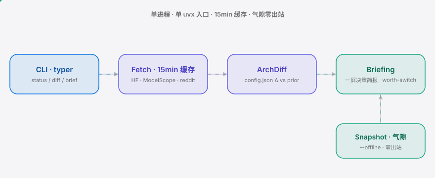

<div align="right"><sub><b>English</b>&nbsp;&nbsp;⇄&nbsp;&nbsp;<a href="./README.md">简体中文</a></sub></div>

<p align="center">
  <picture>
    <source media="(prefers-color-scheme: dark)" srcset="./assets/hero-dark.svg">
    <source media="(prefers-color-scheme: light)" srcset="./assets/hero-light.svg">
    
  </picture>
</p>

<p align="center"><sub>Every CN model drop forces operators to scour reddit / HuggingFace / ModelScope for hours to learn whether it's live, what the architecture changed, which quant actually runs, and whether it's worth switching —— dropbrief compresses those four questions into one cached command, and works offline on air-gapped 信创 boxes.</sub></p>

<h3 align="center">Decide before you download — one command per CN model drop.</h3>

<p align="center">
  <a href="./LICENSE"></a>
  <a href="https://github.com/SuperMarioYL/dropbrief/releases"></a>
  
  
  
  
</p>

---

Every Qwen / GLM / DeepSeek release sends an operator on a multi-hour gauntlet across reddit, HuggingFace, ModelScope and hfviewer: release pages get pulled mid-release (the Qwen3.8 wave was a live example), no one knows which quant actually runs, and whether the architecture actually changed versus the prior version. On an air-gapped 信创/政企 box that manual gauntlet is structurally impossible — there is no egress. dropbrief compresses the research into a single 15-minute-cached command (under 60 seconds), and the same command with `--offline` reads a pre-shipped snapshot so an air-gapped operator gets the identical decision intelligence with zero egress.

##  Architecture

<p align="center">
  <picture>
    <source media="(prefers-color-scheme: dark)" srcset="./assets/atlas-dark.svg">
    <source media="(prefers-color-scheme: light)" srcset="./assets/atlas-light.svg">
    
  </picture>
</p>

Single process, single `uvx` entry, no server, no database. `fetch.py` hits HF+ModelScope+reddit and writes a 15-minute JSON cache; `archdiff.py` field-diffs `config.json` against the prior version; `briefing.py` synthesizes the one-screen briefing; `snapshot.py` lets an air-gapped box replay the identical output via `--offline`. Residual value is deliberately pushed into `archdiff` + `briefing`, not the scraper (see Non-goals and Roadmap).

##  The four questions it answers

| Question | Subcommand | Source | m1 |
| --- | --- | --- | :-: |
| Is it live? | `dropbrief status` | HF + ModelScope HTTP probe + file listing | ✓ |
| Did the architecture change? | `dropbrief diff` | `config.json` field-diff vs the prior drop | ✓ basic |
| Which quant exists? | `dropbrief status` / `brief` | FP8 / GGUF / AWQ inventory across repos | ✓ |
| Worth switching? | `dropbrief brief` | arch×quant×reconfig heuristic | ✓ basic |

##  Install + Quickstart

Cold clone to first visible result, one command (first run is offline — reads the bundled Qwen3.8-27B public snapshot, zero egress):

```bash
uvx dropbrief brief --offline qwen3.8-27b
```

On a connected box, to see live status and the quant inventory:

```bash
uv tool install dropbrief
dropbrief status qwen3.8-27b
```

<details>
<summary>Sample briefing output (<code>dropbrief brief --offline qwen3.8-27b</code>)</summary>

```markdown
# dropbrief briefing — Qwen/Qwen3.8-27B

> 信创 recommendation [HOLD]: Qwen/Qwen3.8-27B — architecture identical to Qwen/Qwen3.6-27B;
> live on huggingface/modelscope; quants FP8/GGUF available; reconfig cost low;
> per the arch×quant×reconfig heuristic, attachable to a purchase memo.

## 1. Is it live?
- ✓ huggingface Qwen/Qwen3.8-27B — HTTP 200 · 34 files
- ✓ modelscope  Qwen/Qwen3.8-27B — HTTP 200 · 34 files

## 2. Did the architecture change?
Qwen/Qwen3.8-27B is architecturally identical to Qwen/Qwen3.6-27B (9 config fields matched, 0 changes).
The version bumped but the structure did not — gains come from training, not architecture.

## 3. Which quant exists?
- ✓ FP8  · huggingface Qwen/Qwen3.8-27B-FP8
- ✓ GGUF · huggingface Qwen/Qwen3.8-27B-GGUF
- ✓ GGUF · modelscope  Qwen/Qwen3.8-27B-GGUF

## 4. Worth switching?
- Verdict: hold · reconfig cost low
- Architecture identical; gains are training-only. Roll forward as the workload demands; no need to rush.
```

</details>

##  Usage

```bash
# m1 falsifier: can ~30 lines of httpx answer live+quant (15-min cache)?
dropbrief status qwen3.8-27b

# architecture delta vs the prior drop (config.json field-level)
dropbrief diff qwen3.8-27b

# one-screen decision briefing, written to dropbrief-qwen3.8-27b-<date>.md
dropbrief brief qwen3.8-27b --out ./briefs

# air-gap offline: read a pre-shipped snapshot, zero egress
dropbrief brief --offline qwen3.8-27b

# list every family the registry supports
dropbrief families
```

Alias resolution is permissive: `qwen3.8-27b` / `Qwen3.8-27B` / `Qwen/Qwen3.8-27B` all resolve to the same record — type whatever a reddit thread quotes.

##  Demo


> The gif above is rendered from `docs/demo.tape` (a vhs script) driving the real binary; `.github/workflows/demo.yml` refreshes it on tag / manual dispatch. Reproduce locally: `vhs docs/demo.tape`.

##  Configuration

The only configuration is `docs/model-families.yaml` (bundled with the package — no clone needed). Edit it when a new drop lands.

| Key | Type | Default | Meaning |
| --- | --- | --- | --- |
| `families[].family` | str | — | family name (qwen3 / glm4 / deepseek / kimi) |
| `families[].vendor` | str | — | vendor |
| `families[].models[].alias` | str | — | drop name a user types |
| `families[].models[].hf_repo` | str | — | HuggingFace repo id |
| `families[].models[].modelscope_id` | str | — | ModelScope repo id |
| `families[].models[].config_path` | str | `config.json` | config file used for arch-diff |
| `families[].models[].prior_alias` | str? | `null` | the prior drop (arch-delta baseline) |
| `families[].models[].quants` | list | `[]` | quant artifact list (kind/repo/surface) |

Environment: `DROPBRIEF_CACHE_DIR` (default `~/.dropbrief/cache`, the 15-min JSON cache), `DROPBRIEF_SNAPSHOT_DIR` (default `~/.dropbrief/snapshots`, user offline snapshots).

##  Air-gapped offline mode

A 信创/政企 air-gapped box has no egress, so it cannot browse reddit / HF / ModelScope at drop time. dropbrief ships a **pre-built snapshot** as the funnel: the repo bundles `snapshots/qwen3.8-27b/brief.json` (a free public snapshot of the latest Qwen drop), so a cold `dropbrief brief --offline qwen3.8-27b` produces the identical briefing with zero network. A connected box runs `dropbrief brief <model>` to build a snapshot, copies it onto the air-gapped box, and replays with `--offline` — the air-gapped operator gets the same decision intelligence the connected one has, which the manual gauntlet structurally cannot.

##  Supported model families

| Family | Vendor | drop | prior version (arch baseline) |
| --- | --- | --- | --- |
| qwen3 | Alibaba | `qwen3.8-27b` / `qwen3.6-27b` | `qwen3.6-27b` |
| glm4 | Zhipu AI | `glm-4.5` / `glm-4` | `glm-4` |
| deepseek | DeepSeek | `deepseek-v3` / `deepseek-v2.5` | `deepseek-v2.5` |
| kimi | Moonshot AI | `kimi-k2` | — |

v0.1 covers Qwen / GLM / DeepSeek / Kimi only (not Llama / Mistral).

##  Non-goals

dropbrief is a **pre-download decision briefing** — it does release-time intelligence, not post-download work:

- Does not download / pull model weights — pre-download briefing, not a release agent
- Does not benchmark — that is dropprobe's job
- Does not diff coding-agent config — that is dropdiff's job
- Does not replay capability regression — that is regatlas's job
- No Web UI / multi-user / cloud sync / push notifications in v0.1
- Does not track custom-trained or fine-tuned models

##  Paid tier

The commercial split is explicit: **live status + quant inventory is OSS/free** (the analysis report judged this layer answerable by a 30-line scraper); **arch-delta intelligence + the 信创 enterprise offline snapshot** is the paid extension (the residual value a scraper cannot answer).

- **Who pays first:** 信创/政企 procurement + enterprise MLOps standardizing a private Qwen/GLM — not hobbyists.
- **What they pay for:** a pre-built, pre-vetted offline decision packet (procurement-grade, signed tarball into the air-gap) plus team seats for the arch-delta extension.
- **Price (estimate):** ¥3,000–5,000 per enterprise drop-snapshot (per drop), or ¥1,000/seat/quarter for the arch-delta team tier. Anchor: a procurement team spends days assembling this packet by hand and a wrong 信创 buy is a six-figure mistake — under ¥5k/drop is a rounding error.
- **Smallest "yes" path:** the free public Qwen snapshot (funnel) → a procurement lead runs `dropbrief brief --offline` on the air-gapped box → sees the arch-delta + worth-switch verdict → DMs from a 微信群 → orders a paid enterprise snapshot for the next GLM-4.5 / DeepSeek-V3 drop, 14-day corporate-transfer invoice.
- **Billing stack:** v0.1 = corporate bank transfer + VAT invoice (manual; 信创/政企 B2G/B2B does not do credit-card SaaS). SaaS billing (WeChat Pay / LemonSqueezy) is deferred to v0.3 if volume warrants.

No pretending a Stripe flow exists for this buyer.

##  Roadmap

- [x] **m1** — HF+ModelScope+reddit fetcher + 15-min JSON cache; `dropbrief status` prints is-live + quant inventory (the falsifier test)
- [ ] **m2** — `dropbrief diff` arch-delta vs prior (basic diff available; full version reproduces the reddit `/comments/1voblcs` identical-architecture finding automatically)
- [ ] **m3** — `dropbrief brief` one-screen briefing + `--offline` (basic briefing + air-gap available; full version adds the worth-switching decision model + the 信创 enterprise signed snapshot)
- [ ] **future** — real GLM-4.5 / DeepSeek-V3 / Kimi K2 data; multi-drop trend analysis; integration with dropdiff

> **Kill triggers** (mvp_plan §8): if across the next 2 real drops the scraper alone answers ≥3/4 dimensions → kill; if the next real drop's briefing saves <5 minutes over a curated reddit thread → kill; if after 30 days on GitHub the repo has <50 stars and no 信创/procurement user files an issue → kill. A plan without a kill trigger ships forever; these three are falsifiable.

## License + Contributing

MIT — see [LICENSE](./LICENSE). File issues / PRs at [Issues](https://github.com/SuperMarioYL/dropbrief/issues). After pushing, set repo topics: `gh repo edit --add-topic llm --add-topic qwen --add-topic cli --add-topic xinchuang`.

<p align="center"><sub><a href="./LICENSE">MIT</a> © 2026 SuperMarioYL</sub></p>
