[简体中文](./README.md) · [Website](https://dropbrief.lei6393.com) · [GitHub](https://github.com/SuperMarioYL/dropbrief)

<picture>
  <source media="(max-width: 600px) and (prefers-color-scheme: dark)" srcset="./assets/presentation/hero-mobile-dark.svg">
  <source media="(max-width: 600px)" srcset="./assets/presentation/hero-mobile-light.svg">
  <source media="(prefers-color-scheme: dark)" srcset="./assets/presentation/hero-dark.svg">
  
</picture>

# dropbrief

**Keep release facts and configuration changes together.**

dropbrief combines registered repository status, quantization listings and selected configuration-field differences into a cached release brief.

## Why use it

Before downloading a model update, operators need the available artifacts and configuration differences in one place. A saved brief also gives an offline environment a dated snapshot to inspect.

- **Consolidate inputs** — Release metadata and prior configuration share one brief.
- **Inspect field changes** — Differences retain old and new values.
- **Read saved snapshots** — Offline mode can consume a previously saved brief.

## Architecture

<picture>
  <source media="(max-width: 600px) and (prefers-color-scheme: dark)" srcset="./assets/presentation/architecture-mobile-dark.svg">
  <source media="(max-width: 600px)" srcset="./assets/presentation/architecture-mobile-light.svg">
  <source media="(prefers-color-scheme: dark)" srcset="./assets/presentation/architecture-dark.svg">
  
</picture>

The registry resolves model aliases and prior versions. Fetch collects configured HTTP metadata into a cache; archdiff compares flattened selected fields. Briefing combines those records with a rule-based switch hint, while snapshot loads saved briefs without a live fetch.

| Component | Responsibility |
| --- | --- |
| `Model registry` | registry.py |
| `Fetch / snapshot` | fetch.py; snapshot.py |
| `Config-field diff` | archdiff.py |
| `Cached brief` | briefing.py |

## Install and quickstart

Build with the version declared in the repository manifest. Run the example from the repository root.

```bash
git clone https://github.com/SuperMarioYL/dropbrief.git
cd dropbrief
uv venv .venv
uv pip install --python .venv/bin/python -e .
source .venv/bin/activate
```

Compare two complete synthetic configurations with a changed hidden_size and a renamed bookkeeping field.

```bash
.venv/bin/python examples/presentation-demo.py
```

## Recorded demo

<picture>
  <source media="(max-width: 600px) and (prefers-color-scheme: dark)" srcset="./assets/presentation/process-mobile-dark.svg">
  <source media="(max-width: 600px)" srcset="./assets/presentation/process-mobile-light.svg">
  <source media="(prefers-color-scheme: dark)" srcset="./assets/presentation/process-dark.svg">
  
</picture>

The production diff reports hidden_size changing from 128 to 256 while excluding _name_or_path.

```text
{
  "identical_compared_fields": false,
  "unchanged_fields": 2,
  "changes": [
    {
      "field": "hidden_size",
      "old": 128,
      "new": 256,
      "change": "changed"
    }
  ]
}
```

The complete command and output are recorded in [docs/demo-results.json](./docs/demo-results.json). Inputs and reproduction code are included in the repository.


The existing recording is retained for context; the text example above documents the reproducible scenario.

## Usage

The CLI exposes the following operations. Commands after the example use your own paths or identifiers.

```bash
dropbrief families
dropbrief brief --offline qwen3.8-27b
# Network access is used by online status:
dropbrief status <registered-alias>
```

## Configuration

docs/model-families.yaml owns registered model aliases, sources and prior_alias. DROPBRIEF_CACHE_DIR selects the cache; DROPBRIEF_SNAPSHOT_DIR selects saved snapshots. Offline snapshots ship inside the package, so `dropbrief brief --offline` works from any install.

## Integrations and responsibilities

<picture>
  <source media="(max-width: 600px) and (prefers-color-scheme: dark)" srcset="./assets/presentation/integrations-mobile-dark.svg">
  <source media="(max-width: 600px)" srcset="./assets/presentation/integrations-mobile-light.svg">
  <source media="(prefers-color-scheme: dark)" srcset="./assets/presentation/integrations-dark.svg">
  
</picture>

The following routes are implemented in the source. Choose the input that matches your task and keep the resulting artifact with your project.

| Route | Implemented role |
| --- | --- |
| Model YAML | Aliases and source repositories |
| HF / ModelScope HTTP | Configured metadata fetch |
| Config JSON | Selected field comparison |
| Offline snapshots | Saved DropBrief JSON |

## Limits and next steps

- An available file listing does not establish that its quantization runs on your hardware.
- Unchanged compared fields do not prove identical architecture or that capability gains came from training. The diff excludes several bookkeeping and token fields.
- The switch hint is a simple heuristic, not a deployment recommendation. Snapshots describe their recorded time, not current availability.

More reliable deployment guidance requires workload benchmarks and target-hardware evidence beyond metadata.

## License and contributions

See [LICENSE](./LICENSE). When reporting an issue, include a minimal input, the command, and the observed output.
